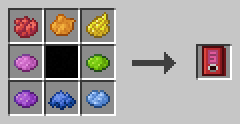

# c0de paint Handbuch

c0de paint ergänzt c0de um die Bibliotheken c0de_paint/cpaint und c0de_paint/schematics. Programme zeichnen Linien, flache Formen und Körper in Leinwände, kombinieren und verändern sie, lesen Schematics von Litematica und Create und bauen sie in der Welt. Jedes Programm hat die Konstante `C0DE_PAINT_VERSION` mit der Version von c0de paint als Text, etwa "0.2.0". Dieses Handbuch beschreibt die Typen, die Stile, die Zeichenfunktionen, die Leinwand-Operationen, das Rendern, die Fehler und die Einstellungen, mit Beispielen.

## Erste Schritte

Programme, die die Bibliothek benutzen, binden sie mit INCLUDE c0de_paint/cpaint ein. Ihre Typen und Funktionen beginnen mit dem Namen der Bibliothek, etwa c0de_paint/cpaint/DRAW_BOX. Der Name zwinkert Deluxe Paint zu, das alle nur DPaint nannten.

Ein Programm zeichnet in eine **Leinwand** (CANVAS), ein dreidimensionales Raster aus Voxeln, und baut sie mit RENDER_CANVAS in der Welt. Ein **Stil** (STYLE) legt fest, wie eine Linie, eine Fläche oder das Innere einer Form gezeichnet wird.

### Die erste Zeichnung

Dieses Programm zeichnet eine Hütte aus Steinziegeln von 7 mal 5 mal 7 Voxeln mit einem Glasfenster auf zwei Seiten und einer Eichentür und baut sie neben dem Auslöserblock. Es braucht allowBlockChanges oder einen Administrator, weil es die Blöcke nicht aus einem Inventar nimmt.

```c0de
PROGRAM hut
NOOP
INCLUDE c0de/minecraft
INCLUDE c0de_paint/cpaint
NOOP
FUNCTION main
    PARAMETER at STRUCT c0de/minecraft/POSITION
BEGIN
    VARIABLE c TYPE c0de_paint/cpaint/CANVAS
    VARIABLE a STRUCT c0de_paint/cpaint/POINT
    VARIABLE b STRUCT c0de_paint/cpaint/POINT
    VARIABLE top STRUCT c0de_paint/cpaint/POINT
    VARIABLE stone STRUCT c0de_paint/cpaint/BLOCK
    VARIABLE pane STRUCT c0de_paint/cpaint/BLOCK
    VARIABLE door STRUCT c0de_paint/cpaint/BLOCK
    VARIABLE walls TYPE c0de_paint/cpaint/STYLE
    VARIABLE empty TYPE c0de_paint/cpaint/STYLE
    VARIABLE glass TYPE c0de_paint/cpaint/STYLE
    VARIABLE lower TYPE c0de_paint/cpaint/STYLE
    VARIABLE upper TYPE c0de_paint/cpaint/STYLE
    ASSIGN stone.id "stone_bricks" ;
    ASSIGN pane.id "glass" ;
    ASSIGN door.id "oak_door" ;
    ASSIGN door.properties["facing"] "north" ;
    ASSIGN door.properties["half"] "lower" ;
    CALL c0de_paint/cpaint/STYLE_SOLID
        PARAMETER block stone ;
        RESULT result walls
    CALL c0de_paint/cpaint/STYLE_EMPTY
        RESULT result empty
    CALL c0de_paint/cpaint/STYLE_SOLID
        PARAMETER block pane ;
        RESULT result glass
    CALL c0de_paint/cpaint/STYLE_SOLID
        PARAMETER block door ;
        RESULT result lower
    ASSIGN door.properties["half"] "upper" ;
    CALL c0de_paint/cpaint/STYLE_SOLID
        PARAMETER block door ;
        RESULT result upper
    NOOP
    ASSIGN b.x 6 ;
    ASSIGN b.y 4 ;
    ASSIGN b.z 6 ;
    CALL c0de_paint/cpaint/DRAW_BOX
        PARAMETER canvas c ;
        PARAMETER from a ;
        PARAMETER to b ;
        PARAMETER side_style walls ;
        PARAMETER fill_style empty ;
    NOOP
    ASSIGN a.x 0 ;
    ASSIGN a.y 2 ;
    ASSIGN a.z 2 ;
    ASSIGN b.x 0 ;
    ASSIGN b.y 2 ;
    ASSIGN b.z 4 ;
    ASSIGN top.x 0 ;
    ASSIGN top.y 3 ;
    ASSIGN top.z 2 ;
    CALL c0de_paint/cpaint/DRAW_RECTANGLE
        PARAMETER canvas c ;
        PARAMETER a a ;
        PARAMETER b b ;
        PARAMETER c top ;
        PARAMETER fill_style glass ;
    ASSIGN a.x 6 ;
    ASSIGN b.x 6 ;
    ASSIGN top.x 6 ;
    CALL c0de_paint/cpaint/DRAW_RECTANGLE
        PARAMETER canvas c ;
        PARAMETER a a ;
        PARAMETER b b ;
        PARAMETER c top ;
        PARAMETER fill_style glass ;
    NOOP
    ASSIGN a.x 3 ;
    ASSIGN a.y 1 ;
    ASSIGN a.z 0 ;
    CALL c0de_paint/cpaint/DRAW_BLOCK
        PARAMETER canvas c ;
        PARAMETER point a ;
        PARAMETER style lower ;
    ASSIGN a.y 2 ;
    CALL c0de_paint/cpaint/DRAW_BLOCK
        PARAMETER canvas c ;
        PARAMETER point a ;
        PARAMETER style upper ;
    NOOP
    CALL c0de_paint/cpaint/RENDER_CANVAS
        PARAMETER canvas c ;
        PARAMETER position at ;
END FUNCTION
```

### Das Handbuch

Dieses Handbuch ist im Spiel ein Ordner, eines der Handbücher von c0de, mit einem rosa Etikett.

**Rezept**



Umgib einen INCLUDE-Block mit acht Farbstoffen in den Farben des Regenbogens: rot, orange, gelb, hellgrün, hellblau, blau, violett und magenta.

### Einstellungen

Der Server hat die Datei `config/c0de_paint.properties`.

- `canvasMin` und `canvasMax` (Standard −128 und 127) begrenzen die Koordinaten einer Leinwand auf jeder Achse.
- `renderBlocksPerTick` (1 bis 1024, Standard 64) ist die Zahl der Blöcke, die RENDER_CANVAS pro Tick setzt.
- `renderMiningSpeed` (0 bis 100, Standard 1) gibt an, wie viel schneller als ein Spieler RENDER_CANVAS Blöcke mit Werkzeugen abbaut; 0 baut sofort ab.
- `canvasVoxelsPerTick` (1024 bis 1048576, Standard 65536) ist die Zahl der Voxel, die eine Zeichenfunktion oder eine Transformation pro Tick bearbeitet. Größere Arbeit verteilt sich auf mehrere Ticks, während der Prozess wartet.
- `maxSchematicSize` (1024 bis 67108864, Standard 4194304) ist die größte Schematic-Datei in Bytes, die c0de_paint/schematics liest.

Jeder Client hat die Datei `config/c0de_paint-client.properties` mit `allowSchematics` (Standard true): ob der Client die Schematics seines Spielers für c0de_paint/schematics liest.

allowBlockChanges, das RENDER_CANVAS ohne input braucht, ist eine Einstellung von c0de in `config/c0de.properties` auf dem Server.

## Typen

Die Bibliothek hat zwei eigene Typen, CANVAS und STYLE, und zwei Structs, POINT und BLOCK. Wie jeder Wert von c0de wird eine Leinwand oder ein Stil beim Zuweisen und Übergeben kopiert. Kopien sind billig: Sie teilen ihren Inhalt, bis eine von ihnen sich ändert.

### CANVAS

Eine Leinwand ist ein dreidimensionales Raster aus Voxeln ohne feste Größe; sie wächst mit ihrem Inhalt. Jedes Voxel ist entweder nicht gesetzt oder enthält einen Block. Luft ist ein Block, ein Voxel kann also absichtlich auf Luft gesetzt werden: Beim Rendern entfernt es den Block an dieser Stelle.

Die Grenzen einer Leinwand sind der kleinste Quader, der alle gesetzten Voxel enthält. Koordinaten dürfen negativ sein, müssen aber innerhalb der Grenzen aus den Einstellungen liegen, sonst löst eine Zeichnung CANVAS_LIMIT aus und zeichnet nichts. SAY und der Debugger zeigen eine Leinwand etwa als "CANVAS 20×10×8, 1600 voxels".

Eine neue Variable enthält eine leere Leinwand. Programme arbeiten mit Leinwänden nur über die Funktionen der Bibliothek. Eine Leinwand lässt sich nicht in JSON oder YAML umwandeln.

```c0de
VARIABLE house TYPE c0de_paint/cpaint/CANVAS
```

### STYLE

Ein Stil legt fest, wie ein Teil einer Form gezeichnet wird: gar nicht, mit Luft, mit einem Block, mit zufälligen Blöcken, mit einem Verlauf oder mit einem Muster. Stile entstehen mit den STYLE-Funktionen. Eine neue Variable enthält STYLE_NONE.

```c0de
VARIABLE brick TYPE c0de_paint/cpaint/STYLE
```

### POINT

Ein Voxel einer Leinwand: die Elemente `x`, `y` und `z`, alle INTEGER. Positionen in der Welt sind POSITIONs von c0de/minecraft.

```c0de
VARIABLE corner STRUCT c0de_paint/cpaint/POINT
ASSIGN corner.y 4 ;
```

### BLOCK

Ein Block eines Stils oder einer Leinwand: `id` STRING, `properties` HASH STRING mit Blockzuständen wie bei PLACE_BLOCK, `weight` INTEGER und `data` STRING. Eine id ohne Namensraum bekommt `minecraft:`, "stone" ist also "minecraft:stone". Gewichte sind 1 oder größer; sie zählen bei zufälligen Blöcken und Verläufen, Leinwände beachten sie nicht. `data` sind die Daten des Blockobjekts als SNBT, der Text, den GET_BLOCK von c0de/minecraft liefert und PLACE_BLOCK nimmt, etwa `{Items:[{Slot:0b,id:"minecraft:stone",count:3}]}` für eine Truhe; "" für keine. Leinwände, Stile und Transformationen behalten sie; wann sie gesetzt werden, steht bei RENDER_CANVAS.

```c0de
VARIABLE log STRUCT c0de_paint/cpaint/BLOCK
ASSIGN log.id "oak_log" ;
ASSIGN log.properties["axis"] "x" ;
ASSIGN log.weight 1 ;
```

## Stile

Jede Form hat bis zu drei Teile, jeder mit eigenem Stil-Parameter: die Linien (`line_style`, Umrisse und Kanten), die Flächen (`side_style`, die Oberfläche eines Körpers) und das Innere (`fill_style`). Die Stil-Parameter sind optional; ihr Standard ist STYLE_NONE.

Ein Teil mit STYLE_NONE übernimmt den Stil des nächsten Teils weiter innen: Linien nehmen den Flächenstil, bei flachen Formen den Füllstil, und Flächen nehmen den Füllstil. Ein Quader mit nur einem Füllstil ist also voll, ein Flächenstil ohne Füllstil ergibt einen hohlen Quader, und nur ein Linienstil ergibt einen Rahmen.

### STYLE_NONE

Nicht zeichnen: Die Voxel bleiben, wie sie sind.

**Parameter und Ergebnisse**

- Ergebnis `result` TYPE c0de_paint/cpaint/STYLE: der Stil

**Beispiel**

```c0de
CALL c0de_paint/cpaint/STYLE_NONE
    RESULT result nothing
```

### STYLE_EMPTY

Luft: löscht Voxel, die vorher gezeichnet wurden. In einen vollen Körper gezeichnet, entstehen hohle Körper mit dicken Wänden.

**Parameter und Ergebnisse**

- Ergebnis `result` TYPE c0de_paint/cpaint/STYLE: der Stil

**Beispiel**

```c0de
CALL c0de_paint/cpaint/STYLE_EMPTY
    RESULT result air
```

### STYLE_SOLID

Immer derselbe Block. Sein Gewicht spielt keine Rolle.

**Parameter und Ergebnisse**

- `block` STRUCT c0de_paint/cpaint/BLOCK: der Block
- Ergebnis `result` TYPE c0de_paint/cpaint/STYLE: der Stil

**Beispiel**

```c0de
CALL c0de_paint/cpaint/STYLE_SOLID
    PARAMETER block stone ;
    RESULT result walls
```

### STYLE_RANDOM

Für jedes Voxel ein zufällig gewählter Block. Die Chance eines Blocks ist sein Gewicht geteilt durch die Summe aller Gewichte. Die Zufallszahlen kommen vom Prozess, wie bei RANDOM; ein Programm, das mit einem festen Startwert läuft, zeichnet also jedes Mal dasselbe.

**Parameter und Ergebnisse**

- `blocks` ARRAY STRUCT c0de_paint/cpaint/BLOCK: die Blöcke mit ihren Gewichten
- Ergebnis `result` TYPE c0de_paint/cpaint/STYLE: der Stil

**Beispiel**

```c0de
CALL c0de_paint/cpaint/STYLE_RANDOM
    PARAMETER blocks stones ;
    RESULT result rubble
```

### STYLE_GRADIENT

Ein Verlauf durch die Blöcke in ihrer Reihenfolge. Bei `from` wird der erste Block gezeichnet. Der Abstand von `from` wird entlang `axes` gemessen: "xyz" ergibt Kugeln, "y" waagrechte Schichten, "xz" Zylinder. Jeder Block bekommt einen Anteil der Länge im Verhältnis seines Gewichts: Fünf schwarze, drei graue und zwei weiße Blöcke ergeben auf einer Linie von 10 Voxeln 5 schwarze, 3 graue und 2 weiße Voxel. Ohne `to` endet der Verlauf am Voxel des Teils, das am weitesten von `from` entfernt ist; Voxel hinter dem Ende bekommen den letzten Block. `fuzzy` verwischt die Grenzen: 1 bis 3 Linien auf jeder Seite nehmen mit einer Chance von 50 %, 25 % und 12,5 % den Nachbarblock.

**Parameter und Ergebnisse**

- `blocks` ARRAY STRUCT c0de_paint/cpaint/BLOCK: die Blöcke in ihrer Reihenfolge, mit ihren Gewichten
- `from` STRUCT c0de_paint/cpaint/POINT: wo der Verlauf beginnt
- `to` STRUCT c0de_paint/cpaint/POINT: wo er endet (optional)
- `axes` STRING: die Achsen des Abstands (optional, Standard "xyz")
- `fuzzy` INTEGER: wie verwischt die Grenzen sind, 0 bis 3 (optional, Standard 0)
- Ergebnis `result` TYPE c0de_paint/cpaint/STYLE: der Stil

**Beispiel**

```c0de
CALL c0de_paint/cpaint/STYLE_GRADIENT
    PARAMETER blocks concrete ;
    PARAMETER from bottom ;
    PARAMETER axes "y" ;
    PARAMETER fuzzy 1 ;
    RESULT result sunset
```

### STYLE_PATTERN

Wiederholt eine Leinwand entlang aller drei Achsen. Eine Wiederholung hat die Größe der Grenzen des Musters, und ihre kleinste Ecke liegt bei `from`. Voxel, die im Muster nicht gesetzt sind, werden nicht gezeichnet. Ein leeres Muster löst CANVAS_EMPTY aus.

**Parameter und Ergebnisse**

- `pattern` TYPE c0de_paint/cpaint/CANVAS: das Muster
- `from` STRUCT c0de_paint/cpaint/POINT: wo eine Wiederholung beginnt (optional, Standard 0,0,0)
- Ergebnis `result` TYPE c0de_paint/cpaint/STYLE: der Stil

**Beispiel**

```c0de
CALL c0de_paint/cpaint/STYLE_PATTERN
    PARAMETER pattern checkers ;
    RESULT result floor
```

### INVENTORY_BLOCKS

Die Blöcke eines Inventars, für STYLE_RANDOM und STYLE_GRADIENT: in der Reihenfolge der Slots, mit der Zahl der Gegenstände als Gewicht. Ein Block in mehreren Slots erscheint einmal, an seinem ersten Slot, mit der Summe der Gegenstände. Gegenstände, die sich nicht als Block setzen lassen, werden übergangen.

Die Gewichte sind Wahrscheinlichkeiten, kein Vorrat: Ein zufälliger Stil kann mehr von einem Block wählen, als das Inventar hat. Rendern mit demselben Inventar als `input` löst dann ITEM_MISSING aus; mit `blocks` "AVAILABLE" setzt RENDER_CANVAS, was das Inventar hat, und nennt den Rest in `missing`.

**Parameter und Ergebnisse**

- `position` STRUCT c0de/minecraft/POSITION: der Block mit dem Inventar, etwa eine Truhe
- Ergebnis `result` ARRAY STRUCT c0de_paint/cpaint/BLOCK: die Blöcke

**Beispiel**

```c0de
CALL c0de_paint/cpaint/INVENTORY_BLOCKS
    PARAMETER position chest ;
    RESULT result palette
```

## Zeichnen

Die Zeichenfunktionen zeichnen in eine Leinwand, die sie als Referenz-Parameter bekommen, so wie INPUT seine Variable bekommt. Ein Voxel gehört zu einer Form, wenn sein Mittelpunkt darin liegt. Linien und Flächen sind ein Voxel dick, und Linien hängen über Kanten und Ecken zusammen.

Flache Formen liegen in einer beliebigen Ebene, die drei Punkte festlegen, meist Punkte der Form selbst. Liegen sie auf einer Geraden, löst die Funktion NOT_A_PLANE aus. Körper sind an den Achsen ausgerichtet oder haben eine der Richtungen "+x", "-x", "+y", "-y", "+z" und "-z"; andere Ausrichtungen entstehen mit CANVAS_ROTATE.

### DRAW_BLOCK

Zeichnet ein Voxel.

**Parameter und Ergebnisse**

- `canvas` TYPE c0de_paint/cpaint/CANVAS: die Leinwand (eine Variable)
- `point` STRUCT c0de_paint/cpaint/POINT: das Voxel
- `style` TYPE c0de_paint/cpaint/STYLE: der Stil

**Beispiel**

```c0de
CALL c0de_paint/cpaint/DRAW_BLOCK
    PARAMETER canvas c ;
    PARAMETER point top ;
    PARAMETER style glowstone ;
```

### DRAW_LINE

Zeichnet eine gerade Linie zwischen zwei Punkten.

**Parameter und Ergebnisse**

- `canvas` TYPE c0de_paint/cpaint/CANVAS: die Leinwand (eine Variable)
- `from` STRUCT c0de_paint/cpaint/POINT: ein Ende
- `to` STRUCT c0de_paint/cpaint/POINT: das andere Ende
- `style` TYPE c0de_paint/cpaint/STYLE: der Stil

**Beispiel**

```c0de
CALL c0de_paint/cpaint/DRAW_LINE
    PARAMETER canvas c ;
    PARAMETER from a ;
    PARAMETER to b ;
    PARAMETER style fence ;
```

### DRAW_RECTANGLE

Zeichnet ein Rechteck. `a` und `b` sind die Enden einer Seite; die andere Seite verläuft senkrecht dazu, bis zum Abstand von `c` zur Geraden durch `a` und `b`. Mit a bei 0,0,0, b bei 9,0,0 und c bei 0,0,4 ist es ein flaches Rechteck von 10 mal 5 Voxeln.

**Parameter und Ergebnisse**

- `canvas` TYPE c0de_paint/cpaint/CANVAS: die Leinwand (eine Variable)
- `a`, `b`, `c` STRUCT c0de_paint/cpaint/POINT: die Punkte
- `line_style`, `fill_style` TYPE c0de_paint/cpaint/STYLE: die Stile (optional)

**Beispiel**

```c0de
CALL c0de_paint/cpaint/DRAW_RECTANGLE
    PARAMETER canvas c ;
    PARAMETER a a ;
    PARAMETER b b ;
    PARAMETER c c ;
    PARAMETER line_style frame ;
    PARAMETER fill_style glass ;
```

### DRAW_POLYGON

Zeichnet ein Vieleck durch die Punkte, automatisch geschlossen. Die ersten drei Punkte, die nicht auf einer Geraden liegen, legen die Ebene fest; Punkte daneben werden auf sie projiziert.

**Parameter und Ergebnisse**

- `canvas` TYPE c0de_paint/cpaint/CANVAS: die Leinwand (eine Variable)
- `points` ARRAY STRUCT c0de_paint/cpaint/POINT: die Ecken
- `line_style`, `fill_style` TYPE c0de_paint/cpaint/STYLE: die Stile (optional)

**Beispiel**

```c0de
CALL c0de_paint/cpaint/DRAW_POLYGON
    PARAMETER canvas c ;
    PARAMETER points gable ;
    PARAMETER fill_style planks ;
```

### DRAW_ELLIPSE

Zeichnet eine Ellipse um `center`. Der Abstand von `a` zum Mittelpunkt ist die erste Halbachse. `b` liegt in der Ebene der Ellipse; sein Abstand zur ersten Achse ist die zweite Halbachse. Ein Kreis hat gleiche Abstände.

**Parameter und Ergebnisse**

- `canvas` TYPE c0de_paint/cpaint/CANVAS: die Leinwand (eine Variable)
- `center`, `a`, `b` STRUCT c0de_paint/cpaint/POINT: die Punkte
- `line_style`, `fill_style` TYPE c0de_paint/cpaint/STYLE: die Stile (optional)

**Beispiel**

```c0de
CALL c0de_paint/cpaint/DRAW_ELLIPSE
    PARAMETER canvas c ;
    PARAMETER center middle ;
    PARAMETER a east ;
    PARAMETER b south ;
    PARAMETER line_style rim ;
```

### DRAW_ARC

Zeichnet den Teil der Ellipse von DRAW_ELLIPSE vom Winkel `start` bis `end`, in Grad, gezählt von `a` nach `b`. Die Linie ist der Bogen; der Füllstil zeichnet ein Tortenstück.

**Parameter und Ergebnisse**

- `canvas` TYPE c0de_paint/cpaint/CANVAS: die Leinwand (eine Variable)
- `center`, `a`, `b` STRUCT c0de_paint/cpaint/POINT: die Punkte der Ellipse
- `start`, `end` FLOAT: die Winkel
- `line_style`, `fill_style` TYPE c0de_paint/cpaint/STYLE: die Stile (optional)

**Beispiel**

```c0de
CALL c0de_paint/cpaint/DRAW_ARC
    PARAMETER canvas c ;
    PARAMETER center middle ;
    PARAMETER a east ;
    PARAMETER b up ;
    PARAMETER start 0 ;
    PARAMETER end 180 ;
    PARAMETER line_style arch ;
```

### DRAW_SPIRAL

Zeichnet eine Spirale auf der Ellipse von DRAW_ELLIPSE, die in Richtung `direction` steigt. Sie beginnt bei `a` und dreht sich in Richtung `b`. Jedes Voxel der Spirale liegt `elevation` Schichten höher als das vorige, abgerundet: 1 steigt eine Schicht pro Voxel, 0.5 bei jedem zweiten Voxel, 2 lässt eine Schicht Lücke. Die Spirale endet unter der Schicht `h`, wie ein Zylinder der Höhe `h`. Die Linie ist die Spirale; der Füllstil zeichnet die Rampe zwischen der Achse durch `center` und der Spirale, wie die Stufen einer Wendeltreppe, mit der Achse in jeder Schicht. Nahe der Achse sind die Stufen einer Rampe nur ein Voxel breit, wie bei einer echten Wendeltreppe; einen dickeren Kern zeichnest du als Zylinder in die Leinwand.

**Parameter und Ergebnisse**

- `canvas` TYPE c0de_paint/cpaint/CANVAS: die Leinwand (eine Variable)
- `center`, `a`, `b` STRUCT c0de_paint/cpaint/POINT: die Punkte der Ellipse
- `direction` STRING: "+x", "-x", "+y", "-y", "+z" oder "-z"
- `elevation` FLOAT: die Schichten von einem Voxel der Spirale zum nächsten, mehr als 0 (optional, Standard 1)
- `h` INTEGER: die Höhe in Schichten
- `line_style`, `fill_style` TYPE c0de_paint/cpaint/STYLE: die Stile (optional)

**Beispiel**

```c0de
CALL c0de_paint/cpaint/DRAW_SPIRAL
    PARAMETER canvas c ;
    PARAMETER center middle ;
    PARAMETER a east ;
    PARAMETER b south ;
    PARAMETER direction "+y" ;
    PARAMETER elevation 0.25 ;
    PARAMETER h 20 ;
    PARAMETER line_style railing ;
    PARAMETER fill_style steps ;
```

### DRAW_BOX

Zeichnet einen achsparallelen Quader zwischen zwei gegenüberliegenden Ecken. Die Linien sind seine 12 Kanten. Ein Würfel ist ein Quader mit gleichen Seiten.

**Parameter und Ergebnisse**

- `canvas` TYPE c0de_paint/cpaint/CANVAS: die Leinwand (eine Variable)
- `from`, `to` STRUCT c0de_paint/cpaint/POINT: die Ecken
- `line_style`, `side_style`, `fill_style` TYPE c0de_paint/cpaint/STYLE: die Stile (optional)

**Beispiel**

```c0de
CALL c0de_paint/cpaint/DRAW_BOX
    PARAMETER canvas c ;
    PARAMETER from a ;
    PARAMETER to b ;
    PARAMETER line_style logs ;
    PARAMETER side_style planks ;
```

### DRAW_ELLIPSOID

Zeichnet ein achsparalleles Ellipsoid mit den Radien `rx`, `ry` und `rz`; eine Kugel, wenn sie gleich sind. Ein Radius von 0 macht es auf dieser Achse flach.

**Parameter und Ergebnisse**

- `canvas` TYPE c0de_paint/cpaint/CANVAS: die Leinwand (eine Variable)
- `center` STRUCT c0de_paint/cpaint/POINT: der Mittelpunkt
- `rx`, `ry`, `rz` INTEGER: die Radien
- `side_style`, `fill_style` TYPE c0de_paint/cpaint/STYLE: die Stile (optional)

**Beispiel**

```c0de
CALL c0de_paint/cpaint/DRAW_ELLIPSOID
    PARAMETER canvas c ;
    PARAMETER center middle ;
    PARAMETER rx 8 ;
    PARAMETER ry 8 ;
    PARAMETER rz 8 ;
    PARAMETER side_style glass ;
```

### DRAW_CYLINDER

Zeichnet einen Zylinder. Der Grundkreis hat seinen Mittelpunkt bei `center` und den Radius `r`; der Zylinder wächst um `h` Voxel in Richtung `direction`. Die Linien sind die Ränder beider Enden; die Flächen sind die ganze Oberfläche, der Mantel und beide Enden. Für ein offenes Rohr zeichnest du die Enden noch einmal mit STYLE_EMPTY.

**Parameter und Ergebnisse**

- `canvas` TYPE c0de_paint/cpaint/CANVAS: die Leinwand (eine Variable)
- `center` STRUCT c0de_paint/cpaint/POINT: der Mittelpunkt der Grundfläche
- `r`, `h` INTEGER: Radius und Höhe
- `direction` STRING: "+x", "-x", "+y", "-y", "+z" oder "-z"
- `line_style`, `side_style`, `fill_style` TYPE c0de_paint/cpaint/STYLE: die Stile (optional)

**Beispiel**

```c0de
CALL c0de_paint/cpaint/DRAW_CYLINDER
    PARAMETER canvas c ;
    PARAMETER center base ;
    PARAMETER r 4 ;
    PARAMETER h 12 ;
    PARAMETER direction "+y" ;
    PARAMETER side_style stone ;
```

### DRAW_CONE

Zeichnet einen Kegel mit der Grundfläche von DRAW_CYLINDER; seine Spitze liegt `h` Voxel von der Grundfläche entfernt in Richtung `direction`. Die Linie ist der Rand der Grundfläche.

**Parameter und Ergebnisse**

- `canvas` TYPE c0de_paint/cpaint/CANVAS: die Leinwand (eine Variable)
- `center` STRUCT c0de_paint/cpaint/POINT: der Mittelpunkt der Grundfläche
- `r`, `h` INTEGER: Radius und Höhe
- `direction` STRING: die Richtung der Spitze
- `line_style`, `side_style`, `fill_style` TYPE c0de_paint/cpaint/STYLE: die Stile (optional)

**Beispiel**

```c0de
CALL c0de_paint/cpaint/DRAW_CONE
    PARAMETER canvas c ;
    PARAMETER center roof ;
    PARAMETER r 5 ;
    PARAMETER h 6 ;
    PARAMETER direction "+y" ;
    PARAMETER fill_style shingles ;
```

### DRAW_PYRAMID

Zeichnet eine Pyramide mit quadratischer Grundfläche, ihre Seiten parallel zu den Achsen. Die halbe Seitenlänge ist `r`; die Spitze liegt `h` Voxel von der Grundfläche entfernt in Richtung `direction`. Die Linien sind die vier Seiten der Grundfläche und die vier Kanten zur Spitze.

**Parameter und Ergebnisse**

- `canvas` TYPE c0de_paint/cpaint/CANVAS: die Leinwand (eine Variable)
- `center` STRUCT c0de_paint/cpaint/POINT: der Mittelpunkt der Grundfläche
- `r`, `h` INTEGER: halbe Seite und Höhe
- `direction` STRING: die Richtung der Spitze
- `line_style`, `side_style`, `fill_style` TYPE c0de_paint/cpaint/STYLE: die Stile (optional)

**Beispiel**

```c0de
CALL c0de_paint/cpaint/DRAW_PYRAMID
    PARAMETER canvas c ;
    PARAMETER center base ;
    PARAMETER r 10 ;
    PARAMETER h 10 ;
    PARAMETER direction "+y" ;
    PARAMETER fill_style sandstone ;
```

### Platonische Körper

DRAW_TETRAHEDRON, DRAW_OCTAHEDRON, DRAW_DODECAHEDRON und DRAW_ICOSAHEDRON zeichnen den platonischen Körper um `center`, alle Ecken im Abstand `r` davon. Die Linien sind ihre Kanten. Jeder hat eine feste Ausrichtung: Das Tetraeder hat seine Ecken in jeder zweiten Ecke eines Würfels, das Oktaeder auf den Achsen, Ikosaeder und Dodekaeder sind über den goldenen Schnitt an den Achsen ausgerichtet. Andere Ausrichtungen entstehen mit CANVAS_ROTATE. Der Würfel ist DRAW_BOX. Weil alle Ecken im Abstand `r` liegen, stehen die Körper nicht auf `center`: Die unterste Ecke des Tetraeders liegt r/√3 (0,58 r) unter dem Mittelpunkt, die der anderen r darunter; verschieb die Leinwand mit CANVAS_MOVE oder nimm CANVAS_MIN, um einen Körper auf den Boden zu stellen. Die Kanten kleiner Körper bleiben auf ihrer Oberfläche.

**Parameter und Ergebnisse**

- `canvas` TYPE c0de_paint/cpaint/CANVAS: die Leinwand (eine Variable)
- `center` STRUCT c0de_paint/cpaint/POINT: der Mittelpunkt
- `r` INTEGER: der Abstand der Ecken
- `line_style`, `side_style`, `fill_style` TYPE c0de_paint/cpaint/STYLE: die Stile (optional)

**Beispiel**

```c0de
CALL c0de_paint/cpaint/DRAW_ICOSAHEDRON
    PARAMETER canvas c ;
    PARAMETER center middle ;
    PARAMETER r 12 ;
    PARAMETER line_style gold ;
```

## Leinwand-Operationen

Diese Funktionen lesen eine Leinwand oder ändern die Leinwand, die sie als Referenz-Parameter bekommen.

### CANVAS_COUNT

Die Zahl der gesetzten Voxel.

**Parameter und Ergebnisse**

- `canvas` TYPE c0de_paint/cpaint/CANVAS: die Leinwand
- Ergebnis `result` INTEGER: die Zahl

**Beispiel**

```c0de
CALL c0de_paint/cpaint/CANVAS_COUNT
    PARAMETER canvas c ;
    RESULT result voxels
```

### CANVAS_MIN und CANVAS_MAX

Die Ecken der Grenzen. Eine leere Leinwand löst CANVAS_EMPTY aus.

**Parameter und Ergebnisse**

- `canvas` TYPE c0de_paint/cpaint/CANVAS: die Leinwand
- Ergebnis `result` STRUCT c0de_paint/cpaint/POINT: die unterste Ecke (CANVAS_MIN) oder die oberste Ecke (CANVAS_MAX)

**Beispiel**

```c0de
CALL c0de_paint/cpaint/CANVAS_MAX
    PARAMETER canvas c ;
    RESULT result top
```

### CANVAS_GET

Der Block eines Voxels, mit dem Gewicht 1. Seine id ist "", wenn das Voxel nicht gesetzt ist, und "minecraft:air" für Luft.

**Parameter und Ergebnisse**

- `canvas` TYPE c0de_paint/cpaint/CANVAS: die Leinwand
- `point` STRUCT c0de_paint/cpaint/POINT: das Voxel
- Ergebnis `result` STRUCT c0de_paint/cpaint/BLOCK: der Block

**Beispiel**

```c0de
CALL c0de_paint/cpaint/CANVAS_GET
    PARAMETER canvas c ;
    PARAMETER point p ;
    RESULT result block
```

### CANVAS_CLEAR und CANVAS_CROP

CANVAS_CLEAR setzt die Voxel im Quader von `from` bis `to` zurück, ohne `from` und `to` alle Voxel. CANVAS_CROP setzt alle Voxel außerhalb des Quaders zurück.

**Parameter und Ergebnisse**

- `canvas` TYPE c0de_paint/cpaint/CANVAS: die Leinwand (eine Variable)
- `from`, `to` STRUCT c0de_paint/cpaint/POINT: der Quader (bei CANVAS_CLEAR optional)

**Beispiel**

```c0de
CALL c0de_paint/cpaint/CANVAS_CROP
    PARAMETER canvas c ;
    PARAMETER from a ;
    PARAMETER to b ;
```

### CANVAS_MOVE

Verschiebt den Inhalt um `offset`.

**Parameter und Ergebnisse**

- `canvas` TYPE c0de_paint/cpaint/CANVAS: die Leinwand (eine Variable)
- `offset` STRUCT c0de_paint/cpaint/POINT: wie weit, auf jeder Achse

**Beispiel**

```c0de
CALL c0de_paint/cpaint/CANVAS_MOVE
    PARAMETER canvas c ;
    PARAMETER offset up ;
```

### CANVAS_REPLACE

Zeichnet jedes Voxel mit dem Block `id` neu mit `style`, egal welche Zustände der Block hat. Der neue Block behält die Zustände des alten, die er auch hat, so behalten Treppen ihre Richtung; die Zustände des Stils haben Vorrang. Die Daten des alten Blocks bleiben, wenn der neue Block keine eigenen hat.

**Parameter und Ergebnisse**

- `canvas` TYPE c0de_paint/cpaint/CANVAS: die Leinwand (eine Variable)
- `id` STRING: der Block, etwa "stone"
- `style` TYPE c0de_paint/cpaint/STYLE: der neue Stil

**Beispiel**

```c0de
CALL c0de_paint/cpaint/CANVAS_REPLACE
    PARAMETER canvas c ;
    PARAMETER id "cobblestone" ;
    PARAMETER style mossy ;
```

### CANVAS_MERGE

Zeichnet `source`, eine Leinwand oder ein ARRAY von Leinwänden, um `offset` verschoben in `target`. Mit dem Modus "OVERWRITE" ersetzen gesetzte Voxel der Quelle die des Ziels; mit "KEEP" füllen sie nur Voxel, die nicht gesetzt sind. Voxel, die in der Quelle nicht gesetzt sind, ändern das Ziel nie; Luft schon.

**Parameter und Ergebnisse**

- `target` TYPE c0de_paint/cpaint/CANVAS: die Leinwand, die sich ändert (eine Variable)
- `source` TYPE c0de_paint/cpaint/CANVAS oder ARRAY TYPE c0de_paint/cpaint/CANVAS: was gezeichnet wird
- `mode` STRING: "OVERWRITE" oder "KEEP" (optional, Standard "OVERWRITE")
- `offset` STRUCT c0de_paint/cpaint/POINT: die Verschiebung (optional, Standard 0,0,0)

**Beispiel**

```c0de
CALL c0de_paint/cpaint/CANVAS_MERGE
    PARAMETER target castle ;
    PARAMETER source tower ;
    PARAMETER offset corner ;
```

### CANVAS_MATERIALS

Die Blöcke einer Leinwand, als HASH von Block-id zu Anzahl, ohne Luft (CANVAS_COUNT zählt Luft mit). Blöcke mit verschiedenen Zuständen zählen zusammen. CANVAS_ITEMS zählt die Gegenstände, die RENDER_CANVAS nimmt.

**Parameter und Ergebnisse**

- `canvas` TYPE c0de_paint/cpaint/CANVAS: die Leinwand
- Ergebnis `result` HASH INTEGER: die Anzahlen

**Beispiel**

```c0de
CALL c0de_paint/cpaint/CANVAS_MATERIALS
    PARAMETER canvas c ;
    RESULT result shopping_list
```

### CANVAS_ITEMS

Die Gegenstände, die RENDER_CANVAS zum Bauen der Leinwand nimmt, als HASH von Gegenstands-ID zu Anzahl: zwei Stufen für eine doppelte Stufe, drei Kerzen für einen Block mit drei Kerzen, ein Blumentopf und die Pflanze für eine eingetopfte Pflanze, ein Wassereimer für Wasser und für jeden geflutteten Block. Die oberen Hälften von Türen und Pflanzen, die Kopfteile von Betten und Kolbenköpfe brauchen nichts, weil der andere Teil sie setzt.

**Parameter und Ergebnisse**

- `canvas` TYPE c0de_paint/cpaint/CANVAS: die Leinwand
- Ergebnis `result` HASH INTEGER: die Gegenstände
- Ergebnis `without_item` HASH INTEGER: die Blöcke nach ID, die kein Gegenstand setzt, wie Feuer

**Beispiel**

```c0de
CALL c0de_paint/cpaint/CANVAS_ITEMS
    PARAMETER canvas c ;
    RESULT result shopping_list
```

### CANVAS_SCALE

Skaliert die Leinwand um `center` auf jeder Achse um einen Prozentsatz von 1 oder mehr. Jedes Voxel nimmt das nächste Voxel des Originals, Blöcke behalten also ihre Zustände.

**Parameter und Ergebnisse**

- `canvas` TYPE c0de_paint/cpaint/CANVAS: die Leinwand (eine Variable)
- `x`, `y`, `z` INTEGER: die Prozentsätze
- `center` STRUCT c0de_paint/cpaint/POINT: der feste Punkt (optional, Standard 0,0,0)

**Beispiel**

```c0de
CALL c0de_paint/cpaint/CANVAS_SCALE
    PARAMETER canvas c ;
    PARAMETER x 200 ;
    PARAMETER y 200 ;
    PARAMETER z 200 ;
```

### CANVAS_ROTATE

Dreht die Leinwand um die Achse "x", "y" oder "z" durch `center`, um einen beliebigen Winkel in Grad. Positive Winkel folgen der Rechte-Hand-Regel: +90 um y dreht Osten nach Norden. Jedes Voxel nimmt das nächste Voxel des Originals, es entstehen also keine Löcher; bei Winkeln, die keine Vielfachen von 90 sind, werden Kanten etwas unregelmäßig. Die Zustände der Blöcke drehen sich mit, soweit Minecraft es erlaubt (facing, axis, rotation, die Formen von Treppen und Schienen), gerundet auf 90°. Einen Zustand, den der Block nicht annehmen kann, behält er wie zuvor: Treppen können nicht nach oben zeigen.

**Parameter und Ergebnisse**

- `canvas` TYPE c0de_paint/cpaint/CANVAS: die Leinwand (eine Variable)
- `center` STRUCT c0de_paint/cpaint/POINT: ein Punkt der Achse
- `axis` STRING: "x", "y" oder "z"
- `degrees` FLOAT: der Winkel

**Beispiel**

```c0de
CALL c0de_paint/cpaint/CANVAS_ROTATE
    PARAMETER canvas c ;
    PARAMETER center middle ;
    PARAMETER axis "y" ;
    PARAMETER degrees 90 ;
```

### CANVAS_MIRROR

Spiegelt die Leinwand an der Ebene senkrecht zur Achse bei `position`, etwa 4.5 für die Ebene zwischen den Voxeln 4 und 5. Ohne `position` spiegelt sie in der Mitte der Grenzen, die Grenzen bleiben also gleich. Die Zustände der Blöcke werden mitgespiegelt, auch die Scharniere von Türen.

**Parameter und Ergebnisse**

- `canvas` TYPE c0de_paint/cpaint/CANVAS: die Leinwand (eine Variable)
- `axis` STRING: "x", "y" oder "z"
- `position` FLOAT: die Ebene (optional)

**Beispiel**

```c0de
CALL c0de_paint/cpaint/CANVAS_MIRROR
    PARAMETER canvas c ;
    PARAMETER axis "x" ;
```

## Rendern

Rendern bringt Leinwände in die Welt, und CANVAS_FROM_WORLD bringt die Welt in eine Leinwand.

### RENDER_CANVAS

Baut die Leinwand in der Welt; ihr Voxel 0,0,0 landet bei `position`. Nicht gesetzte Voxel lassen die Welt, wie sie ist, Luft entfernt den Block dort, und Blöcke, die schon an ihrem Platz sind, werden übersprungen.

Ohne `input` braucht das Programm allowBlockChanges (`config/c0de.properties` von c0de) oder einen Administrator als Besitzer, und Blöcke im Weg werden ersetzt. Mit `input` darf jeder Besitzer rendern: Die Gegenstände kommen zuerst aus `output`, dann aus `input`, so wie CANVAS_ITEMS sie zählt (Wassereimer kommen leer zurück); Blöcke im Weg werden mit den Werkzeugen aus `tools` abgebaut, die dabei abnutzen, und was sie fallen lassen, kommt nach `output`. Blöcke, die ohne Werkzeug abgehen, wie Erde und Glas, werden mit der Hand abgebaut; ohne `output` geht, was sie fallen lassen, verloren. Die Blätter, der Spawnschutz und Blöcke, die ein Spieler nicht abbauen kann, lösen PERMISSION_DENIED aus.

**Blockdaten.** Die Daten der Blöcke (das Element `data`) werden mit ihnen gesetzt. Blöcke mit Inventar behalten ihren Inhalt: Ohne `input` kommen die Gegenstände mit den Daten; mit `input` werden sie wie die Blöcke aus den Inventaren genommen, und `contents` entscheidet, was passiert, wenn welche fehlen: "REQUIRED" (Standard) löst ITEM_MISSING vor dem ersten Block aus, "AVAILABLE" füllt ein, was da ist, "NONE" setzt die Inventare leer. Mit `input` bleibt weg, was aus dem Nichts Dinge erzeugen würde: Beutetabellen, die Bienen von Bienenstöcken, der Gegenstand in seltsamem Sand und Kies, das Buch eines Lesepults. Die Daten von Befehlsblöcken, Konstruktionsblöcken und Verbundblöcken brauchen einen Administrator (PERMISSION_DENIED).

**Fehlende Blöcke.** Mit `blocks` "AVAILABLE" werden die Blöcke gesetzt, die die Inventare haben, und die Voxel der anderen übersprungen, statt ITEM_MISSING auszulösen. Das Ergebnis `missing` nennt nach Gegenstands-ID, was weggelassen wurde, Blöcke und Inhalte, damit das Programm es holen und noch einmal rendern kann: Blöcke, die schon an ihrem Platz sind, werden übersprungen und behalten ihren Inhalt.

Vor dem ersten Block prüft RENDER_CANVAS die Rechte, die Chunks (CHUNK_NOT_LOADED), die Blöcke in den Inventaren (ITEM_MISSING) und ein Werkzeug für jeden Block, der eines braucht, damit ein Fehler kein halbes Gebäude hinterlässt. Ein volles `output` (INVENTORY_FULL) oder ein zerbrochenes Werkzeug halten es später an; die Meldung sagt, wie viele Blöcke gesetzt wurden. Der Prozess wartet während des Renderns: Es setzt `renderBlocksPerTick` Blöcke pro Tick, von unten nach oben, und Fackeln, Leitern und Ähnliches nach den anderen Blöcken ihrer Schicht. Das Abbauen dauert so lange wie bei einem Spieler, geteilt durch `renderMiningSpeed`.

**Parameter und Ergebnisse**

- `canvas` TYPE c0de_paint/cpaint/CANVAS: die Leinwand
- `position` STRUCT c0de/minecraft/POSITION: wo das Voxel 0,0,0 landet
- `input` STRUCT c0de/minecraft/POSITION: das Inventar mit den Blöcken (optional)
- `tools` STRUCT c0de/minecraft/POSITION: das Inventar mit den Werkzeugen (optional)
- `output` STRUCT c0de/minecraft/POSITION: das Inventar für entfernte Blöcke, wird zuerst für Blöcke benutzt (optional)
- `contents` STRING: "REQUIRED", "AVAILABLE" oder "NONE", für den Inhalt von Inventaren (optional, Standard "REQUIRED")
- `blocks` STRING: "REQUIRED" oder "AVAILABLE", für fehlende Blöcke (optional, Standard "REQUIRED")
- Ergebnis `missing` HASH INTEGER: was weggelassen wurde, nach Gegenstands-ID

**Beispiel**

```c0de
CALL c0de_paint/cpaint/RENDER_CANVAS
    PARAMETER canvas c ;
    PARAMETER position site ;
    PARAMETER input supplies ;
    PARAMETER tools toolbox ;
    PARAMETER output rubble ;
```

### CANVAS_FROM_WORLD

Eine neue Leinwand mit den Blöcken der Welt zwischen zwei Positionen, mit ihren Zuständen und ihren Daten (dem Inhalt von Truhen, dem Text von Schildern); `from` wird zu 0,0,0. Luft wird zu nicht gesetzt, oder zu Luft, wenn `air` TRUE ist. Jede Ecke muss von `from` aus gesehen in den Grenzen einer Leinwand liegen: mit den Standardeinstellungen bis zu 127 Blöcke in positiver und 128 in negativer Richtung jeder Achse; sonst CANVAS_LIMIT. Nicht geladene Chunks lösen CHUNK_NOT_LOADED aus.

**Parameter und Ergebnisse**

- `from`, `to` STRUCT c0de/minecraft/POSITION: die Ecken des Bereichs
- `air` BOOLEAN: auch Luft kopieren (optional, Standard FALSE)
- Ergebnis `result` TYPE c0de_paint/cpaint/CANVAS: die Leinwand

**Beispiel**

```c0de
CALL c0de_paint/cpaint/CANVAS_FROM_WORLD
    PARAMETER from corner ;
    PARAMETER to other_corner ;
    RESULT result copy
```

## Schematics

Die Bibliothek c0de_paint/schematics liest die Schematics, die Spieler mit Litematica (`.litematic`) und Create (`.nbt`, die Strukturdateien von Minecraft) speichern, in Leinwände. Ein Programm bindet sie mit INCLUDE c0de_paint/schematics ein, und c0de_paint/cpaint für die Leinwände.

**Wo die Dateien liegen.** Beide Mods speichern Schematics im Ordner `schematics` des Spielordners des Spielers. Auf einem Server liegt dieser Ordner auf dem Computer des Spielers, deshalb liest der **Client des Spielers, der den Prozess ausführt,** die Datei und schickt sie zum Server; der Prozess wartet solange auf seiner CALL-Zeile. Der Spieler muss online sein und c0de paint installiert haben (CLIENT_UNAVAILABLE). Jeder Spieler entscheidet auf seinem Computer, ob sein Client Schematics liest: `allowSchematics` in `config/c0de_paint-client.properties` (Vorgabe true; mit false SCHEMATICS_DISABLED). Im Einzelspieler sind Server und Client derselbe Computer.

**Namen.** Eine Datei wird relativ zum Ordner `schematics` benannt, mit `/` zwischen Ordnern, etwa "castles/keep.litematic". Namen, die den Ordner verlassen (`..`, absolute Pfade, Laufwerksbuchstaben) oder versteckte Zeichen enthalten, lösen INVALID_ARGUMENT aus.

**Was aus einer Schematic wird.** Die Blöcke mit ihren Zuständen und den Daten ihrer Blockobjekte (der Text von Schildern, die Gegenstände von Truhen, die Einstellungen von Maschinen), die kleinste Ecke auf Voxel 0,0,0; die Regionen einer `.litematic` behalten ihre Lage zueinander. Luft bleibt ungesetzt. Objekte (Rahmen, Rüstungsständer) werden weggelassen und gezählt. Schematics älterer Minecraft-Versionen werden aktualisiert, wie Minecraft seine Welten aktualisiert, umbenannte Blöcke kommen also mit ihren neuen Namen heraus; Dateien von vor Minecraft 1.13 werden nicht gelesen. Eine Schematic, die größer als eine Leinwand ist (canvasMin, canvasMax), löst SCHEMATIC_TOO_LARGE aus, ebenso eine Datei, die größer als `maxSchematicSize` ist.

**Blöcke ersetzen.** Jede Funktion nimmt den optionalen Parameter `replace`, einen HASH STRING von Block zu Block, der beim Lesen der Datei angewendet wird. Ein Schlüssel ist eine ID wie "create:andesite_casing" oder eine ID mit Zuständen wie "oak_stairs[half=top]"; der Schlüssel mit den meisten passenden Zuständen gewinnt. Der neue Block behält die Zustände des alten, die er auch hat, so behalten Treppen ihre Richtung, und die Daten, wenn der neue Block keine eigenen hat. Der Wert "" lässt die Voxel ungesetzt.

### SCHEMATIC_LOAD

Die Schematic als Leinwand.

**Parameter und Ergebnisse**

- `file` STRING: der Name der Schematic
- `replace` HASH STRING: zu ersetzende Blöcke (optional)
- `region` STRING: nur diese Region einer `.litematic` (optional, Vorgabe alle)
- Ergebnis `result` TYPE c0de_paint/cpaint/CANVAS: die Leinwand
- Ergebnis `entities` INTEGER: die Zahl der weggelassenen Objekte

**Beispiel**

```c0de
VARIABLE swap HASH STRING
ASSIGN swap["create:andesite_casing"] "stripped_spruce_log" ;
CALL c0de_paint/schematics/SCHEMATIC_LOAD
    PARAMETER file "castles/keep.litematic" ;
    PARAMETER replace swap ;
    RESULT result keep
```

### SCHEMATIC_MATERIALS

Die Gegenstände, die RENDER_CANVAS zum Bauen der Schematic nimmt, als HASH von Gegenstands-ID zu Anzahl, gezählt wie bei CANVAS_ITEMS. Die Funktion braucht keine Leinwand, sie zählt also auch Schematics, die größer als eine Leinwand sind.

**Parameter und Ergebnisse**

- `file` STRING: der Name der Schematic
- `replace` HASH STRING: zu ersetzende Blöcke (optional)
- Ergebnis `result` HASH INTEGER: die Gegenstände
- Ergebnis `without_item` HASH INTEGER: die Blöcke nach ID, die kein Gegenstand setzt, wie Feuer

**Beispiel**

```c0de
CALL c0de_paint/schematics/SCHEMATIC_MATERIALS
    PARAMETER file "castles/keep.litematic" ;
    RESULT result shopping_list
```

### SCHEMATIC_MISSING

Die Blöcke der Schematic, die dieser Server nicht hat, als HASH von Block-ID zu Anzahl; leer, wenn die Schematic hier gebaut werden kann. Blöcke von Mods, die nicht installiert sind, etwa die Blöcke von Create auf einem Server ohne Create, und Blöcke neuerer Minecraft-Versionen erscheinen hier. Ruf die Funktion mit dem `replace` auf, das du verwenden willst, um es zu prüfen.

**Parameter und Ergebnisse**

- `file` STRING: der Name der Schematic
- `replace` HASH STRING: zu ersetzende Blöcke (optional)
- Ergebnis `result` HASH INTEGER: die fehlenden Blöcke

**Beispiel**

```c0de
CALL c0de_paint/schematics/SCHEMATIC_MISSING
    PARAMETER file "factory.nbt" ;
    PARAMETER replace swap ;
    RESULT result missing
```

### SCHEMATIC_LIST

Die Schematics in einem Ordner von `schematics` und seinen Unterordnern, sortiert, als Namen, die die anderen Funktionen nehmen.

**Parameter und Ergebnisse**

- `folder` STRING: der Ordner (optional, Vorgabe der Ordner `schematics` selbst)
- Ergebnis `result` ARRAY STRING: die Namen

**Beispiel**

```c0de
CALL c0de_paint/schematics/SCHEMATIC_LIST
    PARAMETER folder "castles" ;
    RESULT result names
```

## Fehler

Die Bibliotheken lösen die Fehler von c0de aus, wo sie passen, und eigene, die Konstanten der Bibliotheken sind, etwa c0de_paint/cpaint/CANVAS_LIMIT und c0de_paint/schematics/SCHEMATIC_NOT_FOUND.

### CANVAS_LIMIT

Code 1100. Eine Zeichnung oder Operation würde ein Voxel außerhalb der Grenzen aus den Einstellungen setzen (canvasMin, canvasMax). Es wird nichts gezeichnet.

### CANVAS_EMPTY

Code 1101. Die Leinwand hat keine gesetzten Voxel und damit keine Grenzen: CANVAS_MIN, CANVAS_MAX und STYLE_PATTERN mit einem leeren Muster.

### NOT_A_PLANE

Code 1102. Die Punkte einer flachen Form liegen auf einer Geraden und legen daher keine Ebene fest.

### SCHEMATIC_NOT_FOUND

Code 1103, c0de_paint/schematics. Im Ordner `schematics` gibt es keine Schematic und keinen Ordner mit dem Namen.

### SCHEMATIC_INVALID

Code 1104, c0de_paint/schematics. Die Datei ist keine Schematic von Litematica oder Create, stammt von vor Minecraft 1.13 oder hat keine Region mit dem Namen.

### SCHEMATIC_TOO_LARGE

Code 1105, c0de_paint/schematics. Die Datei ist größer als `maxSchematicSize` oder die Schematic größer als eine Leinwand.

### CLIENT_UNAVAILABLE

Code 1106, c0de_paint/schematics. Der Spieler, der den Prozess ausführt, ist nicht online, hat c0de paint nicht auf dem Client oder antwortet nicht innerhalb von 60 Sekunden. Prozesse ohne einen solchen Spieler (ein Zeitgeberblock ohne Besitzer) können keine Schematics lesen.

### SCHEMATICS_DISABLED

Code 1107, c0de_paint/schematics. Der Client des Spielers liest keine Schematics (`allowSchematics` ist false).

### Fehler von c0de

INVALID_ARGUMENT (309): ein Argument ist falsch, etwa ein Gewicht unter 1, eine unbekannte Richtung oder ein unbekannter Block. PERMISSION_DENIED (311), CHUNK_NOT_LOADED (310), ITEM_MISSING (313) und INVENTORY_FULL (312) kommen vom Rendern, wie bei PLACE_BLOCK und MINE_BLOCK.

## Beispiele

### Ein Turm mit spitzem Dach

Ein runder Turm aus Steinziegeln mit einem Kegel aus Schwarzeichenbrettern obendrauf.

```c0de
PROGRAM tower
NOOP
INCLUDE c0de/minecraft
INCLUDE c0de_paint/cpaint
NOOP
FUNCTION main
    PARAMETER at STRUCT c0de/minecraft/POSITION
BEGIN
    VARIABLE c TYPE c0de_paint/cpaint/CANVAS
    VARIABLE base STRUCT c0de_paint/cpaint/POINT
    VARIABLE bricks STRUCT c0de_paint/cpaint/BLOCK
    VARIABLE planks STRUCT c0de_paint/cpaint/BLOCK
    VARIABLE walls TYPE c0de_paint/cpaint/STYLE
    VARIABLE roof TYPE c0de_paint/cpaint/STYLE
    VARIABLE empty TYPE c0de_paint/cpaint/STYLE
    ASSIGN bricks.id "stone_bricks" ;
    ASSIGN planks.id "dark_oak_planks" ;
    CALL c0de_paint/cpaint/STYLE_SOLID
        PARAMETER block bricks ;
        RESULT result walls
    CALL c0de_paint/cpaint/STYLE_SOLID
        PARAMETER block planks ;
        RESULT result roof
    CALL c0de_paint/cpaint/STYLE_EMPTY
        RESULT result empty
    CALL c0de_paint/cpaint/DRAW_CYLINDER
        PARAMETER canvas c ;
        PARAMETER center base ;
        PARAMETER r 4 ;
        PARAMETER h 12 ;
        PARAMETER direction "+y" ;
        PARAMETER side_style walls ;
        PARAMETER fill_style empty ;
    ASSIGN base.y 12 ;
    CALL c0de_paint/cpaint/DRAW_CONE
        PARAMETER canvas c ;
        PARAMETER center base ;
        PARAMETER r 5 ;
        PARAMETER h 6 ;
        PARAMETER direction "+y" ;
        PARAMETER fill_style roof ;
    CALL c0de_paint/cpaint/RENDER_CANVAS
        PARAMETER canvas c ;
        PARAMETER position at ;
END FUNCTION
```

### Ein Schotterweg aus einer Truhe

Ein Weg aus zufälligen Blöcken aus einer Truhe, den jeder Spieler bauen kann: Die Blöcke kommen aus der Truhe, die Werkzeuge aus einer zweiten Truhe, und was im Weg ist, landet in einer dritten.

```c0de
PROGRAM path
NOOP
INCLUDE c0de/minecraft
INCLUDE c0de_paint/cpaint
NOOP
FUNCTION main
    PARAMETER at STRUCT c0de/minecraft/POSITION
    PARAMETER supplies STRUCT c0de/minecraft/POSITION
    PARAMETER toolbox STRUCT c0de/minecraft/POSITION
    PARAMETER rubble STRUCT c0de/minecraft/POSITION
BEGIN
    VARIABLE c TYPE c0de_paint/cpaint/CANVAS
    VARIABLE a STRUCT c0de_paint/cpaint/POINT
    VARIABLE b STRUCT c0de_paint/cpaint/POINT
    VARIABLE blocks ARRAY STRUCT c0de_paint/cpaint/BLOCK
    VARIABLE gravel TYPE c0de_paint/cpaint/STYLE
    ASSIGN b.x 15 ;
    ASSIGN b.z 2 ;
    CALL c0de_paint/cpaint/INVENTORY_BLOCKS
        PARAMETER position supplies ;
        RESULT result blocks
    CALL c0de_paint/cpaint/STYLE_RANDOM
        PARAMETER blocks blocks ;
        RESULT result gravel
    CALL c0de_paint/cpaint/DRAW_BOX
        PARAMETER canvas c ;
        PARAMETER from a ;
        PARAMETER to b ;
        PARAMETER fill_style gravel ;
    CALL c0de_paint/cpaint/RENDER_CANVAS
        PARAMETER canvas c ;
        PARAMETER position at ;
        PARAMETER input supplies ;
        PARAMETER tools toolbox ;
        PARAMETER output rubble ;
END FUNCTION
```
