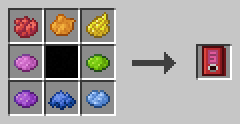

# c0de paint Handbook

c0de paint adds the library c0de_paint/cpaint to c0de. Programs draw lines, flat shapes and bodies into canvases, combine and transform them, and build them in the world. This handbook describes the types, the styles, the drawing functions, the canvas operations, rendering, the errors and the settings, with examples.

## Getting started

Programs that use the library include it with INCLUDE c0de_paint/cpaint. Its types and functions start with the library name, like c0de_paint/cpaint/DRAW_BOX. The name is a wink at Deluxe Paint, which everybody called DPaint.

A program draws into a **canvas**, a three-dimensional grid of voxels, and builds it in the world with RENDER_CANVAS. A **style** says how a line, a face or the inside of a shape is drawn.

### First drawing

This program draws a hut of stone bricks of 7 by 5 by 7 voxels with a glass window on two sides and an oak door, and builds it next to the trigger block. It needs allowBlockChanges or an administrator, because it doesn't take the blocks from an inventory.

```c0de
PROGRAM hut
NOOP
INCLUDE c0de/minecraft
INCLUDE c0de_paint/cpaint
NOOP
FUNCTION main
    PARAMETER at STRUCT c0de/minecraft/POSITION
BEGIN
    VARIABLE c TYPE c0de_paint/cpaint/CANVAS
    VARIABLE a STRUCT c0de_paint/cpaint/POINT
    VARIABLE b STRUCT c0de_paint/cpaint/POINT
    VARIABLE top STRUCT c0de_paint/cpaint/POINT
    VARIABLE stone STRUCT c0de_paint/cpaint/BLOCK
    VARIABLE pane STRUCT c0de_paint/cpaint/BLOCK
    VARIABLE door STRUCT c0de_paint/cpaint/BLOCK
    VARIABLE walls TYPE c0de_paint/cpaint/STYLE
    VARIABLE empty TYPE c0de_paint/cpaint/STYLE
    VARIABLE glass TYPE c0de_paint/cpaint/STYLE
    VARIABLE lower TYPE c0de_paint/cpaint/STYLE
    VARIABLE upper TYPE c0de_paint/cpaint/STYLE
    ASSIGN stone.id "stone_bricks" ;
    ASSIGN pane.id "glass" ;
    ASSIGN door.id "oak_door" ;
    ASSIGN door.properties["facing"] "north" ;
    ASSIGN door.properties["half"] "lower" ;
    CALL c0de_paint/cpaint/STYLE_SOLID
        PARAMETER block stone ;
        RESULT result walls
    CALL c0de_paint/cpaint/STYLE_EMPTY
        RESULT result empty
    CALL c0de_paint/cpaint/STYLE_SOLID
        PARAMETER block pane ;
        RESULT result glass
    CALL c0de_paint/cpaint/STYLE_SOLID
        PARAMETER block door ;
        RESULT result lower
    ASSIGN door.properties["half"] "upper" ;
    CALL c0de_paint/cpaint/STYLE_SOLID
        PARAMETER block door ;
        RESULT result upper
    NOOP
    ASSIGN b.x 6 ;
    ASSIGN b.y 4 ;
    ASSIGN b.z 6 ;
    CALL c0de_paint/cpaint/DRAW_BOX
        PARAMETER canvas c ;
        PARAMETER from a ;
        PARAMETER to b ;
        PARAMETER side_style walls ;
        PARAMETER fill_style empty ;
    NOOP
    ASSIGN a.x 0 ;
    ASSIGN a.y 2 ;
    ASSIGN a.z 2 ;
    ASSIGN b.x 0 ;
    ASSIGN b.y 2 ;
    ASSIGN b.z 4 ;
    ASSIGN top.x 0 ;
    ASSIGN top.y 3 ;
    ASSIGN top.z 2 ;
    CALL c0de_paint/cpaint/DRAW_RECTANGLE
        PARAMETER canvas c ;
        PARAMETER a a ;
        PARAMETER b b ;
        PARAMETER c top ;
        PARAMETER fill_style glass ;
    ASSIGN a.x 6 ;
    ASSIGN b.x 6 ;
    ASSIGN top.x 6 ;
    CALL c0de_paint/cpaint/DRAW_RECTANGLE
        PARAMETER canvas c ;
        PARAMETER a a ;
        PARAMETER b b ;
        PARAMETER c top ;
        PARAMETER fill_style glass ;
    NOOP
    ASSIGN a.x 3 ;
    ASSIGN a.y 1 ;
    ASSIGN a.z 0 ;
    CALL c0de_paint/cpaint/DRAW_LINE
        PARAMETER canvas c ;
        PARAMETER from a ;
        PARAMETER to a ;
        PARAMETER style lower ;
    ASSIGN a.y 2 ;
    CALL c0de_paint/cpaint/DRAW_LINE
        PARAMETER canvas c ;
        PARAMETER from a ;
        PARAMETER to a ;
        PARAMETER style upper ;
    NOOP
    CALL c0de_paint/cpaint/RENDER_CANVAS
        PARAMETER canvas c ;
        PARAMETER position at ;
END FUNCTION
```

### The handbook

This handbook is a binder in the game, one of the handbooks of c0de, with a label in pink.

**Recipe**



Surround an INCLUDE block with eight dyes in the colours of the rainbow: red, orange, yellow, lime, light blue, blue, purple and magenta.

### Settings

The server has the file `config/c0de_paint.properties`.

- `canvasMin` and `canvasMax` (default −128 and 127) limit the coordinates of a canvas on every axis.
- `renderBlocksPerTick` (1 to 1024, default 64) is the number of blocks RENDER_CANVAS places per tick.
- `renderMiningSpeed` (0 to 100, default 1) is how much faster than a player RENDER_CANVAS mines blocks with tools; 0 mines instantly.
- `canvasVoxelsPerTick` (1024 to 1048576, default 65536) is the number of voxels a drawing function or a transformation processes per tick. Larger work is spread over several ticks while the process waits.

## Types

The library has two types of its own, CANVAS and STYLE, and two structs, POINT and BLOCK. Like every value of c0de, a canvas or a style is copied when it is assigned or passed. Copies are cheap: they share their content until one of them changes.

### CANVAS

A canvas is a three-dimensional grid of voxels without a fixed size; it grows with its content. Every voxel is either not set or holds a block. Air is a block, so a voxel can be set to air on purpose: rendering removes the block there.

The bounds of a canvas are the smallest box that holds all set voxels. Coordinates may be negative, but must lie within the limits of the settings, otherwise a drawing raises CANVAS_LIMIT and draws nothing. SAY and the debugger show a canvas like "CANVAS 20×10×8, 1600 voxels".

A new variable holds an empty canvas. Programs only work with canvases through the functions of the library. A canvas can't be converted to JSON or YAML.

```c0de
VARIABLE house TYPE c0de_paint/cpaint/CANVAS
```

### STYLE

A style says how a part of a shape is drawn: not at all, with air, with one block, with random blocks, with a gradient or with a pattern. Styles are made with the STYLE functions. A new variable holds STYLE_NONE.

```c0de
VARIABLE brick TYPE c0de_paint/cpaint/STYLE
```

### POINT

A voxel of a canvas: the elements `x`, `y` and `z`, all INTEGER. Positions in the world are POSITIONs of c0de/minecraft.

```c0de
VARIABLE corner STRUCT c0de_paint/cpaint/POINT
ASSIGN corner.y 4 ;
```

### BLOCK

A block of a style or of a canvas: `id` STRING, `properties` HASH STRING with block states as in PLACE_BLOCK, and `weight` INTEGER. An id without a namespace gets `minecraft:`, so "stone" is "minecraft:stone". Weights are 1 or more; they matter for random blocks and gradients.

```c0de
VARIABLE log STRUCT c0de_paint/cpaint/BLOCK
ASSIGN log.id "oak_log" ;
ASSIGN log.properties["axis"] "x" ;
ASSIGN log.weight 1 ;
```

## Styles

Every shape has up to three parts, each with its own style parameter: the lines (`line_style`, outlines and edges), the faces (`side_style`, the surface of a body) and the inside (`fill_style`). The style parameters are optional; their default is STYLE_NONE.

A part with STYLE_NONE takes the style of the next part inward: lines take the side style, or the fill style of flat shapes, and faces take the fill style. So a box with only a fill style is full, a side style without a fill style gives a hollow box, and only a line style gives a frame.

### STYLE_NONE

Don't draw: the voxels stay as they are.

**Parameters and results**

- result `result` TYPE c0de_paint/cpaint/STYLE: the style

**Example**

```c0de
CALL c0de_paint/cpaint/STYLE_NONE
    RESULT result nothing
```

### STYLE_EMPTY

Air: erases voxels that were drawn before. Drawn into a full body, it makes hollow bodies with thick walls.

**Parameters and results**

- result `result` TYPE c0de_paint/cpaint/STYLE: the style

**Example**

```c0de
CALL c0de_paint/cpaint/STYLE_EMPTY
    RESULT result air
```

### STYLE_SOLID

Always the same block. Its weight doesn't matter.

**Parameters and results**

- `block` STRUCT c0de_paint/cpaint/BLOCK: the block
- result `result` TYPE c0de_paint/cpaint/STYLE: the style

**Example**

```c0de
CALL c0de_paint/cpaint/STYLE_SOLID
    PARAMETER block stone ;
    RESULT result walls
```

### STYLE_RANDOM

For every voxel a randomly chosen block. The chance of a block is its weight divided by the sum of all weights. The random numbers come from the process, like RANDOM, so a program started with a fixed seed draws the same every time.

**Parameters and results**

- `blocks` ARRAY STRUCT c0de_paint/cpaint/BLOCK: the blocks with their weights
- result `result` TYPE c0de_paint/cpaint/STYLE: the style

**Example**

```c0de
CALL c0de_paint/cpaint/STYLE_RANDOM
    PARAMETER blocks stones ;
    RESULT result rubble
```

### STYLE_GRADIENT

A gradient through the blocks in their order. The first block is drawn at `from`. The distance from `from` is measured along `axes`: "xyz" gives spheres, "y" horizontal layers, "xz" cylinders. Every block gets a share of the length in proportion to its weight: five black, three gray and two white blocks give a line of 10 voxels 5 black, 3 gray and 2 white voxels. Without `to`, the gradient ends at the voxel of the part that is farthest from `from`; voxels beyond the end get the last block. `fuzzy` blurs the borders: 1 to 3 lines on each side take the neighbouring block with a chance of 50 %, 25 % and 12.5 %.

**Parameters and results**

- `blocks` ARRAY STRUCT c0de_paint/cpaint/BLOCK: the blocks in their order, with their weights
- `from` STRUCT c0de_paint/cpaint/POINT: where the gradient starts
- `to` STRUCT c0de_paint/cpaint/POINT: where it ends (optional)
- `axes` STRING: the axes of the distance (optional, default "xyz")
- `fuzzy` INTEGER: how blurred the borders are, 0 to 3 (optional, default 0)
- result `result` TYPE c0de_paint/cpaint/STYLE: the style

**Example**

```c0de
CALL c0de_paint/cpaint/STYLE_GRADIENT
    PARAMETER blocks concrete ;
    PARAMETER from bottom ;
    PARAMETER axes "y" ;
    PARAMETER fuzzy 1 ;
    RESULT result sunset
```

### STYLE_PATTERN

Repeats a canvas along all three axes. One repetition has the size of the bounds of the pattern, and its minimum corner lies at `from`. Voxels that are not set in the pattern are not drawn. An empty pattern raises CANVAS_EMPTY.

**Parameters and results**

- `pattern` TYPE c0de_paint/cpaint/CANVAS: the pattern
- `from` STRUCT c0de_paint/cpaint/POINT: where a repetition starts (optional, default 0,0,0)
- result `result` TYPE c0de_paint/cpaint/STYLE: the style

**Example**

```c0de
CALL c0de_paint/cpaint/STYLE_PATTERN
    PARAMETER pattern checkers ;
    RESULT result floor
```

### INVENTORY_BLOCKS

The blocks of an inventory, for STYLE_RANDOM and STYLE_GRADIENT: in the order of the slots, with the number of items as weight. A block in several slots is listed once, at its first slot, with the sum of the items. Items that can't be placed as blocks are ignored.

**Parameters and results**

- `position` STRUCT c0de/minecraft/POSITION: the block with the inventory, like a chest
- result `result` ARRAY STRUCT c0de_paint/cpaint/BLOCK: the blocks

**Example**

```c0de
CALL c0de_paint/cpaint/INVENTORY_BLOCKS
    PARAMETER position chest ;
    RESULT result palette
```

## Drawing

The drawing functions draw into a canvas, which they get as a reference parameter, like INPUT gets its variable. A voxel belongs to a shape when its center lies inside. Lines and faces are one voxel thick, and lines connect through edges and corners.

Flat shapes lie in any plane, given by three points, usually points of the shape itself. If they lie on one line, the function raises NOT_A_PLANE. Bodies are axis-aligned or have one of the directions "+x", "-x", "+y", "-y", "+z" and "-z"; other orientations come from CANVAS_ROTATE.

### DRAW_BLOCK

Draws one voxel.

**Parameters and results**

- `canvas` TYPE c0de_paint/cpaint/CANVAS: the canvas (a variable)
- `point` STRUCT c0de_paint/cpaint/POINT: the voxel
- `style` TYPE c0de_paint/cpaint/STYLE: the style

**Example**

```c0de
CALL c0de_paint/cpaint/DRAW_BLOCK
    PARAMETER canvas c ;
    PARAMETER point top ;
    PARAMETER style glowstone ;
```

### DRAW_LINE

Draws a straight line between two points.

**Parameters and results**

- `canvas` TYPE c0de_paint/cpaint/CANVAS: the canvas (a variable)
- `from` STRUCT c0de_paint/cpaint/POINT: one end
- `to` STRUCT c0de_paint/cpaint/POINT: the other end
- `style` TYPE c0de_paint/cpaint/STYLE: the style

**Example**

```c0de
CALL c0de_paint/cpaint/DRAW_LINE
    PARAMETER canvas c ;
    PARAMETER from a ;
    PARAMETER to b ;
    PARAMETER style fence ;
```

### DRAW_RECTANGLE

Draws a rectangle. `a` and `b` are the ends of one side; the other side runs perpendicular to it, up to the distance of `c` from the line through `a` and `b`. With a at 0,0,0, b at 9,0,0 and c at 0,0,4, it is a flat rectangle of 10 by 5 voxels.

**Parameters and results**

- `canvas` TYPE c0de_paint/cpaint/CANVAS: the canvas (a variable)
- `a`, `b`, `c` STRUCT c0de_paint/cpaint/POINT: the points
- `line_style`, `fill_style` TYPE c0de_paint/cpaint/STYLE: the styles (optional)

**Example**

```c0de
CALL c0de_paint/cpaint/DRAW_RECTANGLE
    PARAMETER canvas c ;
    PARAMETER a a ;
    PARAMETER b b ;
    PARAMETER c c ;
    PARAMETER line_style frame ;
    PARAMETER fill_style glass ;
```

### DRAW_POLYGON

Draws a polygon through the points, closed automatically. The first three points that don't lie on one line define the plane; points beside it are projected onto it.

**Parameters and results**

- `canvas` TYPE c0de_paint/cpaint/CANVAS: the canvas (a variable)
- `points` ARRAY STRUCT c0de_paint/cpaint/POINT: the corners
- `line_style`, `fill_style` TYPE c0de_paint/cpaint/STYLE: the styles (optional)

**Example**

```c0de
CALL c0de_paint/cpaint/DRAW_POLYGON
    PARAMETER canvas c ;
    PARAMETER points gable ;
    PARAMETER fill_style planks ;
```

### DRAW_ELLIPSE

Draws an ellipse around `center`. The distance of `a` from the center is the first semi-axis. `b` lies in the plane of the ellipse; its distance from the first axis is the second semi-axis. A circle has equal distances.

**Parameters and results**

- `canvas` TYPE c0de_paint/cpaint/CANVAS: the canvas (a variable)
- `center`, `a`, `b` STRUCT c0de_paint/cpaint/POINT: the points
- `line_style`, `fill_style` TYPE c0de_paint/cpaint/STYLE: the styles (optional)

**Example**

```c0de
CALL c0de_paint/cpaint/DRAW_ELLIPSE
    PARAMETER canvas c ;
    PARAMETER center middle ;
    PARAMETER a east ;
    PARAMETER b south ;
    PARAMETER line_style rim ;
```

### DRAW_ARC

Draws the part of the ellipse of DRAW_ELLIPSE from the angle `start` to `end`, in degrees, counted from `a` towards `b`. The line is the arc; the fill style draws a pie slice.

**Parameters and results**

- `canvas` TYPE c0de_paint/cpaint/CANVAS: the canvas (a variable)
- `center`, `a`, `b` STRUCT c0de_paint/cpaint/POINT: the points of the ellipse
- `start`, `end` FLOAT: the angles
- `line_style`, `fill_style` TYPE c0de_paint/cpaint/STYLE: the styles (optional)

**Example**

```c0de
CALL c0de_paint/cpaint/DRAW_ARC
    PARAMETER canvas c ;
    PARAMETER center middle ;
    PARAMETER a east ;
    PARAMETER b up ;
    PARAMETER start 0 ;
    PARAMETER end 180 ;
    PARAMETER line_style arch ;
```

### DRAW_BOX

Draws an axis-aligned box between two opposite corners. The lines are its 12 edges. A cube is a box with equal sides.

**Parameters and results**

- `canvas` TYPE c0de_paint/cpaint/CANVAS: the canvas (a variable)
- `from`, `to` STRUCT c0de_paint/cpaint/POINT: the corners
- `line_style`, `side_style`, `fill_style` TYPE c0de_paint/cpaint/STYLE: the styles (optional)

**Example**

```c0de
CALL c0de_paint/cpaint/DRAW_BOX
    PARAMETER canvas c ;
    PARAMETER from a ;
    PARAMETER to b ;
    PARAMETER line_style logs ;
    PARAMETER side_style planks ;
```

### DRAW_ELLIPSOID

Draws an axis-aligned ellipsoid with the radii `rx`, `ry` and `rz`; a sphere when they are equal. A radius of 0 makes it flat on that axis.

**Parameters and results**

- `canvas` TYPE c0de_paint/cpaint/CANVAS: the canvas (a variable)
- `center` STRUCT c0de_paint/cpaint/POINT: the center
- `rx`, `ry`, `rz` INTEGER: the radii
- `side_style`, `fill_style` TYPE c0de_paint/cpaint/STYLE: the styles (optional)

**Example**

```c0de
CALL c0de_paint/cpaint/DRAW_ELLIPSOID
    PARAMETER canvas c ;
    PARAMETER center middle ;
    PARAMETER rx 8 ;
    PARAMETER ry 8 ;
    PARAMETER rz 8 ;
    PARAMETER side_style glass ;
```

### DRAW_CYLINDER

Draws a cylinder. The base circle has its center at `center` and the radius `r`; the cylinder grows by `h` voxels in `direction`. The lines are the rims of both ends.

**Parameters and results**

- `canvas` TYPE c0de_paint/cpaint/CANVAS: the canvas (a variable)
- `center` STRUCT c0de_paint/cpaint/POINT: the center of the base
- `r`, `h` INTEGER: the radius and the height
- `direction` STRING: "+x", "-x", "+y", "-y", "+z" or "-z"
- `line_style`, `side_style`, `fill_style` TYPE c0de_paint/cpaint/STYLE: the styles (optional)

**Example**

```c0de
CALL c0de_paint/cpaint/DRAW_CYLINDER
    PARAMETER canvas c ;
    PARAMETER center base ;
    PARAMETER r 4 ;
    PARAMETER h 12 ;
    PARAMETER direction "+y" ;
    PARAMETER side_style stone ;
```

### DRAW_CONE

Draws a cone with the base of DRAW_CYLINDER; its tip lies `h` voxels from the base in `direction`. The line is the rim of the base.

**Parameters and results**

- `canvas` TYPE c0de_paint/cpaint/CANVAS: the canvas (a variable)
- `center` STRUCT c0de_paint/cpaint/POINT: the center of the base
- `r`, `h` INTEGER: the radius and the height
- `direction` STRING: the direction of the tip
- `line_style`, `side_style`, `fill_style` TYPE c0de_paint/cpaint/STYLE: the styles (optional)

**Example**

```c0de
CALL c0de_paint/cpaint/DRAW_CONE
    PARAMETER canvas c ;
    PARAMETER center roof ;
    PARAMETER r 5 ;
    PARAMETER h 6 ;
    PARAMETER direction "+y" ;
    PARAMETER fill_style shingles ;
```

### DRAW_PYRAMID

Draws a pyramid with a square base, its sides parallel to the axes. Half the length of a side is `r`; the tip lies `h` voxels from the base in `direction`. The lines are the four sides of the base and the four edges to the tip.

**Parameters and results**

- `canvas` TYPE c0de_paint/cpaint/CANVAS: the canvas (a variable)
- `center` STRUCT c0de_paint/cpaint/POINT: the center of the base
- `r`, `h` INTEGER: half the side and the height
- `direction` STRING: the direction of the tip
- `line_style`, `side_style`, `fill_style` TYPE c0de_paint/cpaint/STYLE: the styles (optional)

**Example**

```c0de
CALL c0de_paint/cpaint/DRAW_PYRAMID
    PARAMETER canvas c ;
    PARAMETER center base ;
    PARAMETER r 10 ;
    PARAMETER h 10 ;
    PARAMETER direction "+y" ;
    PARAMETER fill_style sandstone ;
```

### Platonic solids

DRAW_TETRAHEDRON, DRAW_OCTAHEDRON, DRAW_DODECAHEDRON and DRAW_ICOSAHEDRON draw the Platonic solid around `center`, with all corners at the distance `r` from it. The lines are their edges. Each has a fixed orientation: the tetrahedron has its corners in alternate corners of a cube, the octahedron on the axes, the icosahedron and the dodecahedron are aligned with the axes by the golden ratio. Other orientations come from CANVAS_ROTATE. The cube is DRAW_BOX.

**Parameters and results**

- `canvas` TYPE c0de_paint/cpaint/CANVAS: the canvas (a variable)
- `center` STRUCT c0de_paint/cpaint/POINT: the center
- `r` INTEGER: the distance of the corners
- `line_style`, `side_style`, `fill_style` TYPE c0de_paint/cpaint/STYLE: the styles (optional)

**Example**

```c0de
CALL c0de_paint/cpaint/DRAW_ICOSAHEDRON
    PARAMETER canvas c ;
    PARAMETER center middle ;
    PARAMETER r 12 ;
    PARAMETER line_style gold ;
```

## Canvas operations

These functions read a canvas, or change the canvas they get as a reference parameter.

### CANVAS_COUNT

The number of set voxels.

**Parameters and results**

- `canvas` TYPE c0de_paint/cpaint/CANVAS: the canvas
- result `result` INTEGER: the number

**Example**

```c0de
CALL c0de_paint/cpaint/CANVAS_COUNT
    PARAMETER canvas c ;
    RESULT result voxels
```

### CANVAS_MIN and CANVAS_MAX

The corners of the bounds. An empty canvas raises CANVAS_EMPTY.

**Parameters and results**

- `canvas` TYPE c0de_paint/cpaint/CANVAS: the canvas
- result `result` STRUCT c0de_paint/cpaint/POINT: the lowest corner (CANVAS_MIN) or the highest corner (CANVAS_MAX)

**Example**

```c0de
CALL c0de_paint/cpaint/CANVAS_MAX
    PARAMETER canvas c ;
    RESULT result top
```

### CANVAS_GET

The block of a voxel, with the weight 1. Its id is "" if the voxel is not set, and "minecraft:air" for air.

**Parameters and results**

- `canvas` TYPE c0de_paint/cpaint/CANVAS: the canvas
- `point` STRUCT c0de_paint/cpaint/POINT: the voxel
- result `result` STRUCT c0de_paint/cpaint/BLOCK: the block

**Example**

```c0de
CALL c0de_paint/cpaint/CANVAS_GET
    PARAMETER canvas c ;
    PARAMETER point p ;
    RESULT result block
```

### CANVAS_CLEAR and CANVAS_CROP

CANVAS_CLEAR unsets the voxels in the box from `from` to `to`, or all voxels without them. CANVAS_CROP unsets all voxels outside the box.

**Parameters and results**

- `canvas` TYPE c0de_paint/cpaint/CANVAS: the canvas (a variable)
- `from`, `to` STRUCT c0de_paint/cpaint/POINT: the box (optional for CANVAS_CLEAR)

**Example**

```c0de
CALL c0de_paint/cpaint/CANVAS_CROP
    PARAMETER canvas c ;
    PARAMETER from a ;
    PARAMETER to b ;
```

### CANVAS_MOVE

Moves the content by `offset`.

**Parameters and results**

- `canvas` TYPE c0de_paint/cpaint/CANVAS: the canvas (a variable)
- `offset` STRUCT c0de_paint/cpaint/POINT: how far, on every axis

**Example**

```c0de
CALL c0de_paint/cpaint/CANVAS_MOVE
    PARAMETER canvas c ;
    PARAMETER offset up ;
```

### CANVAS_REPLACE

Draws every voxel with the block `id` again with `style`, whatever the states of the block are.

**Parameters and results**

- `canvas` TYPE c0de_paint/cpaint/CANVAS: the canvas (a variable)
- `id` STRING: the block, like "stone"
- `style` TYPE c0de_paint/cpaint/STYLE: the new style

**Example**

```c0de
CALL c0de_paint/cpaint/CANVAS_REPLACE
    PARAMETER canvas c ;
    PARAMETER id "cobblestone" ;
    PARAMETER style mossy ;
```

### CANVAS_MERGE

Draws `source`, a canvas or an ARRAY of canvases, into `target`, moved by `offset`. With mode "OVERWRITE", set voxels of the source replace those of the target; with "KEEP", they only fill voxels that are not set. Voxels that are not set in the source never change the target; air does.

**Parameters and results**

- `target` TYPE c0de_paint/cpaint/CANVAS: the canvas that changes (a variable)
- `source` TYPE c0de_paint/cpaint/CANVAS or ARRAY TYPE c0de_paint/cpaint/CANVAS: what is drawn
- `mode` STRING: "OVERWRITE" or "KEEP" (optional, default "OVERWRITE")
- `offset` STRUCT c0de_paint/cpaint/POINT: the shift (optional, default 0,0,0)

**Example**

```c0de
CALL c0de_paint/cpaint/CANVAS_MERGE
    PARAMETER target castle ;
    PARAMETER source tower ;
    PARAMETER offset corner ;
```

### CANVAS_MATERIALS

The blocks a canvas needs, as a HASH from block id to number, without air. Blocks with different states count together.

**Parameters and results**

- `canvas` TYPE c0de_paint/cpaint/CANVAS: the canvas
- result `result` HASH INTEGER: the numbers

**Example**

```c0de
CALL c0de_paint/cpaint/CANVAS_MATERIALS
    PARAMETER canvas c ;
    RESULT result shopping_list
```

### CANVAS_SCALE

Scales the canvas around `center` along every axis by a percentage of 1 or more. Every voxel takes the nearest voxel of the original, so blocks keep their states.

**Parameters and results**

- `canvas` TYPE c0de_paint/cpaint/CANVAS: the canvas (a variable)
- `x`, `y`, `z` INTEGER: the percentages
- `center` STRUCT c0de_paint/cpaint/POINT: the fixed point (optional, default 0,0,0)

**Example**

```c0de
CALL c0de_paint/cpaint/CANVAS_SCALE
    PARAMETER canvas c ;
    PARAMETER x 200 ;
    PARAMETER y 200 ;
    PARAMETER z 200 ;
```

### CANVAS_ROTATE

Rotates the canvas around the axis "x", "y" or "z" through `center` by any angle in degrees. Positive angles follow the right-hand rule: +90 about y turns east to north. Every voxel takes the nearest voxel of the original, so there are no holes; at angles that aren't multiples of 90, edges become a little irregular. The states of the blocks turn as far as Minecraft allows (facing, axis, rotation, the shapes of stairs and rails), rounded to 90°. A state the block can't take stays as it was: stairs can't face up.

**Parameters and results**

- `canvas` TYPE c0de_paint/cpaint/CANVAS: the canvas (a variable)
- `center` STRUCT c0de_paint/cpaint/POINT: a point of the axis
- `axis` STRING: "x", "y" or "z"
- `degrees` FLOAT: the angle

**Example**

```c0de
CALL c0de_paint/cpaint/CANVAS_ROTATE
    PARAMETER canvas c ;
    PARAMETER center middle ;
    PARAMETER axis "y" ;
    PARAMETER degrees 90 ;
```

### CANVAS_MIRROR

Mirrors the canvas at the plane perpendicular to the axis at `position`, like 4.5 for the plane between the voxels 4 and 5. Without `position`, it mirrors at the middle of the bounds, so the bounds stay the same. The states of the blocks are mirrored too, also the hinges of doors.

**Parameters and results**

- `canvas` TYPE c0de_paint/cpaint/CANVAS: the canvas (a variable)
- `axis` STRING: "x", "y" or "z"
- `position` FLOAT: the plane (optional)

**Example**

```c0de
CALL c0de_paint/cpaint/CANVAS_MIRROR
    PARAMETER canvas c ;
    PARAMETER axis "x" ;
```

## Rendering

Rendering brings canvases into the world, and CANVAS_FROM_WORLD brings the world into a canvas.

### RENDER_CANVAS

Builds the canvas in the world; its voxel 0,0,0 lands at `position`. Voxels that are not set leave the world as it is, air removes the block there, and blocks that are already in place are skipped.

Without `input`, the program needs allowBlockChanges or an administrator as owner, and blocks in the way are replaced. With `input`, every owner may render: the blocks come from `output` first, then from `input`; blocks in the way are mined with the tools of `tools`, which take damage, and the drops go to `output`. The sheets, the spawn protection and blocks a player can't break raise PERMISSION_DENIED.

Before the first block, RENDER_CANVAS checks the rights, the chunks (CHUNK_NOT_LOADED), the blocks in the inventories (ITEM_MISSING) and a tool for every block that needs one, so an error doesn't leave half a building. A full output (INVENTORY_FULL) or a broken tool stop it later; the message says how many blocks were placed. The process waits while rendering: it places `renderBlocksPerTick` blocks per tick, from bottom to top, and torches, ladders and the like after the other blocks of their layer. Mining takes the time of a player divided by `renderMiningSpeed`.

**Parameters and results**

- `canvas` TYPE c0de_paint/cpaint/CANVAS: the canvas
- `position` STRUCT c0de/minecraft/POSITION: where the voxel 0,0,0 lands
- `input` STRUCT c0de/minecraft/POSITION: the inventory with the blocks (optional)
- `tools` STRUCT c0de/minecraft/POSITION: the inventory with the tools (optional)
- `output` STRUCT c0de/minecraft/POSITION: the inventory for removed blocks, used first for blocks (optional)

**Example**

```c0de
CALL c0de_paint/cpaint/RENDER_CANVAS
    PARAMETER canvas c ;
    PARAMETER position site ;
    PARAMETER input supplies ;
    PARAMETER tools toolbox ;
    PARAMETER output rubble ;
```

### CANVAS_FROM_WORLD

A new canvas with the blocks of the world between two positions, with their states; `from` becomes 0,0,0. Air becomes not set, or air if `air` is TRUE. The contents of chests and other block data are not copied. A region larger than the limits raises CANVAS_LIMIT, chunks that are not loaded CHUNK_NOT_LOADED.

**Parameters and results**

- `from`, `to` STRUCT c0de/minecraft/POSITION: the corners of the region
- `air` BOOLEAN: copy air too (optional, default FALSE)
- result `result` TYPE c0de_paint/cpaint/CANVAS: the canvas

**Example**

```c0de
CALL c0de_paint/cpaint/CANVAS_FROM_WORLD
    PARAMETER from corner ;
    PARAMETER to other_corner ;
    RESULT result copy
```

## Errors

The library raises the errors of c0de where they fit and three of its own, which are constants of the library, like c0de_paint/cpaint/CANVAS_LIMIT.

### CANVAS_LIMIT

Code 1100. A drawing or an operation would set a voxel outside the limits of the settings (canvasMin, canvasMax). Nothing is drawn.

### CANVAS_EMPTY

Code 1101. The canvas has no set voxels, so it has no bounds: CANVAS_MIN, CANVAS_MAX, and STYLE_PATTERN with an empty pattern.

### NOT_A_PLANE

Code 1102. The points of a flat shape lie on one line, so they don't define a plane.

### Errors of c0de

INVALID_ARGUMENT (309): an argument is wrong, like a weight below 1, an unknown direction or block. PERMISSION_DENIED (311), CHUNK_NOT_LOADED (310), ITEM_MISSING (313) and INVENTORY_FULL (312) come from rendering, as with PLACE_BLOCK and MINE_BLOCK.

## Examples

### A tower with a pointed roof

A round tower of stone bricks with a cone of dark oak planks on top.

```c0de
PROGRAM tower
NOOP
INCLUDE c0de/minecraft
INCLUDE c0de_paint/cpaint
NOOP
FUNCTION main
    PARAMETER at STRUCT c0de/minecraft/POSITION
BEGIN
    VARIABLE c TYPE c0de_paint/cpaint/CANVAS
    VARIABLE base STRUCT c0de_paint/cpaint/POINT
    VARIABLE bricks STRUCT c0de_paint/cpaint/BLOCK
    VARIABLE planks STRUCT c0de_paint/cpaint/BLOCK
    VARIABLE walls TYPE c0de_paint/cpaint/STYLE
    VARIABLE roof TYPE c0de_paint/cpaint/STYLE
    VARIABLE empty TYPE c0de_paint/cpaint/STYLE
    ASSIGN bricks.id "stone_bricks" ;
    ASSIGN planks.id "dark_oak_planks" ;
    CALL c0de_paint/cpaint/STYLE_SOLID
        PARAMETER block bricks ;
        RESULT result walls
    CALL c0de_paint/cpaint/STYLE_SOLID
        PARAMETER block planks ;
        RESULT result roof
    CALL c0de_paint/cpaint/STYLE_EMPTY
        RESULT result empty
    CALL c0de_paint/cpaint/DRAW_CYLINDER
        PARAMETER canvas c ;
        PARAMETER center base ;
        PARAMETER r 4 ;
        PARAMETER h 12 ;
        PARAMETER direction "+y" ;
        PARAMETER side_style walls ;
        PARAMETER fill_style empty ;
    ASSIGN base.y 12 ;
    CALL c0de_paint/cpaint/DRAW_CONE
        PARAMETER canvas c ;
        PARAMETER center base ;
        PARAMETER r 5 ;
        PARAMETER h 6 ;
        PARAMETER direction "+y" ;
        PARAMETER fill_style roof ;
    CALL c0de_paint/cpaint/RENDER_CANVAS
        PARAMETER canvas c ;
        PARAMETER position at ;
END FUNCTION
```

### A rubble path from a chest

A path of random blocks from a chest, built by any player: the blocks come from the chest, the tools from a second chest, and whatever is in the way goes into a third.

```c0de
PROGRAM path
NOOP
INCLUDE c0de/minecraft
INCLUDE c0de_paint/cpaint
NOOP
FUNCTION main
    PARAMETER at STRUCT c0de/minecraft/POSITION
    PARAMETER supplies STRUCT c0de/minecraft/POSITION
    PARAMETER toolbox STRUCT c0de/minecraft/POSITION
    PARAMETER rubble STRUCT c0de/minecraft/POSITION
BEGIN
    VARIABLE c TYPE c0de_paint/cpaint/CANVAS
    VARIABLE a STRUCT c0de_paint/cpaint/POINT
    VARIABLE b STRUCT c0de_paint/cpaint/POINT
    VARIABLE blocks ARRAY STRUCT c0de_paint/cpaint/BLOCK
    VARIABLE gravel TYPE c0de_paint/cpaint/STYLE
    ASSIGN b.x 15 ;
    ASSIGN b.z 2 ;
    CALL c0de_paint/cpaint/INVENTORY_BLOCKS
        PARAMETER position supplies ;
        RESULT result blocks
    CALL c0de_paint/cpaint/STYLE_RANDOM
        PARAMETER blocks blocks ;
        RESULT result gravel
    CALL c0de_paint/cpaint/DRAW_BOX
        PARAMETER canvas c ;
        PARAMETER from a ;
        PARAMETER to b ;
        PARAMETER fill_style gravel ;
    CALL c0de_paint/cpaint/RENDER_CANVAS
        PARAMETER canvas c ;
        PARAMETER position at ;
        PARAMETER input supplies ;
        PARAMETER tools toolbox ;
        PARAMETER output rubble ;
END FUNCTION
```
